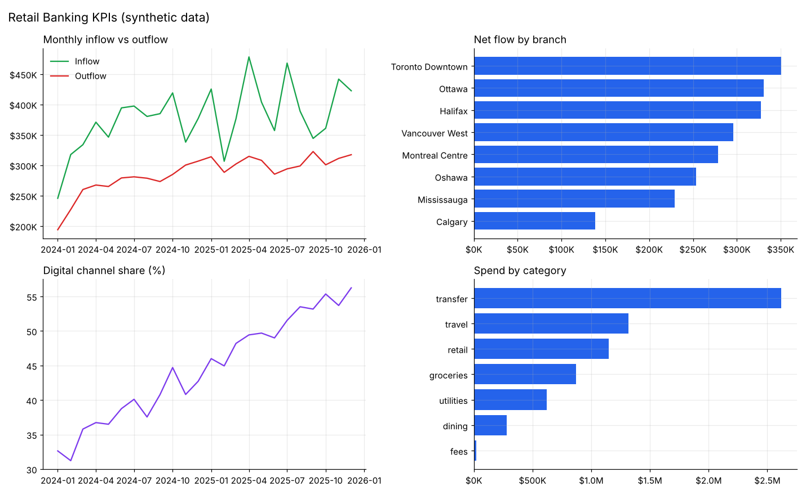
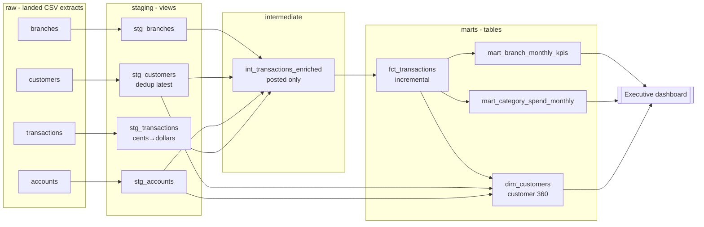

# 🏦 Banking Analytics Pipeline

**An end-to-end ELT pipeline (raw → staging → marts → dashboard) built with dbt and DuckDB, with data-quality tests at every layer.**

[](https://github.com/silverlookz/banking-analytics-pipeline/actions)     

The BI work that matters most is rarely the dashboard. It's making sure the numbers *behind* the dashboard are right, reproducible and explainable. This project models a retail-banking domain the way I'd structure it in a production warehouse:

- **Layered modelling:** `raw` (untouched) → `staging` (typed, cleaned, deduplicated) → `intermediate` (business joins) → `marts` (facts, dimensions, KPI tables).
- **Messy source data on purpose:** duplicate CRM rows, mixed-case codes, untrimmed strings, missing emails, amounts in cents, reversed/pending transactions and late-arriving records. Each issue is fixed in exactly one, documented place.
- **30 data tests:** uniqueness, not-null, referential integrity, accepted values, a custom `non_negative` generic test, and singular tests that reconcile marts back to staging.
- **Incremental fact table** with a 3-day lookback for late-arriving data.
- **Exposure-tracked dashboard** so lineage runs from source file all the way to the chart.
- **Zero infrastructure:** DuckDB runs in-process, so `make all` builds the whole warehouse on a laptop in seconds. The same dbt models port to Snowflake, Databricks or BigQuery by changing the profile.

> All data is **synthetic**, generated with a fixed seed: 800 customers, ~1,400 accounts, 40,000 transactions across 8 Canadian branches, Jan 2024 – Dec 2025.

---



## Lineage



## Data quality issues and where they're handled

| Issue in source | Handled in | How |
|---|---|---|
| Duplicate customers from CRM re-syncs | `stg_customers` | `row_number()` over `customer_id`, keep latest `_updated_at` |
| Mixed-case segments / categories (`AFFLUENT`, `Dining`) | staging | `lower(trim())`, then `accepted_values` tests |
| Untrimmed branch names | `stg_branches` | `trim()` |
| Empty strings instead of NULL (email, birth year, close date) | staging | `nullif()` + `try_cast()` |
| Amounts stored in cents | staging | `cents_to_dollars` macro |
| Pending and reversed transactions | `int_transactions_enriched` | only `posted` flows to marts |
| Late-arriving transactions (up to 9 days) | `fct_transactions` | incremental model with 3-day lookback on `loaded_at` |

## Tests

```text
$ make all
...
Done. PASS=39 WARN=0 ERROR=0 SKIP=0 TOTAL=40
```

Besides schema tests, two singular tests guard the numbers business users see:

- `assert_marts_reconcile_to_staging`: posted transaction count in the fact must equal staging. During development this caught stale rows left in the incremental table after a full source reload, and blocked every downstream model until a `--full-refresh`, which is exactly the behaviour you want.
- `assert_inflow_outflow_balance`: `net_flow = inflow + outflow` for every branch-month.

A pytest suite also runs the full pipeline into a temporary warehouse and checks deduplication, posted-only filtering and mart grain.

## Quickstart

```bash
git clone https://github.com/silverlookz/banking-analytics-pipeline.git
cd banking-analytics-pipeline
python -m venv .venv && source .venv/bin/activate
pip install -r requirements.txt

make all          # extract/load raw data + dbt build (models + tests)
make dashboard    # Streamlit dashboard
make docs         # dbt docs site with column docs and lineage graph
make test         # end-to-end pytest
```

Without `make`: `python ingest/extract_load.py && cd transform && dbt build --profiles-dir . --full-refresh`.

## Project structure

```
├── ingest/extract_load.py           # generate raw CSVs, land in DuckDB schema `raw`
├── transform/                       # dbt project
│   ├── models/staging/              # typing, cleaning, dedup + source & column tests
│   ├── models/intermediate/         # business joins
│   ├── models/marts/                # fct / dim / KPI marts + exposure
│   ├── macros/                      # cents_to_dollars, non_negative test, schema naming
│   └── tests/                       # singular reconciliation tests
├── dashboard/                       # Streamlit app + static renderer
└── tests/                           # end-to-end pipeline test
```

## Moving it to a cloud warehouse

1. Add a `snowflake` / `databricks` / `bigquery` output to `transform/profiles.yml`.
2. Replace `ingest/extract_load.py` with Fivetran/Airbyte or a cloud storage stage.
3. Swap the DuckDB-specific functions (`date_diff`, `any_value`) where the target dialect differs.
4. Schedule `dbt build` in Airflow / dbt Cloud, with `dbt source freshness` before it.

## License

MIT
